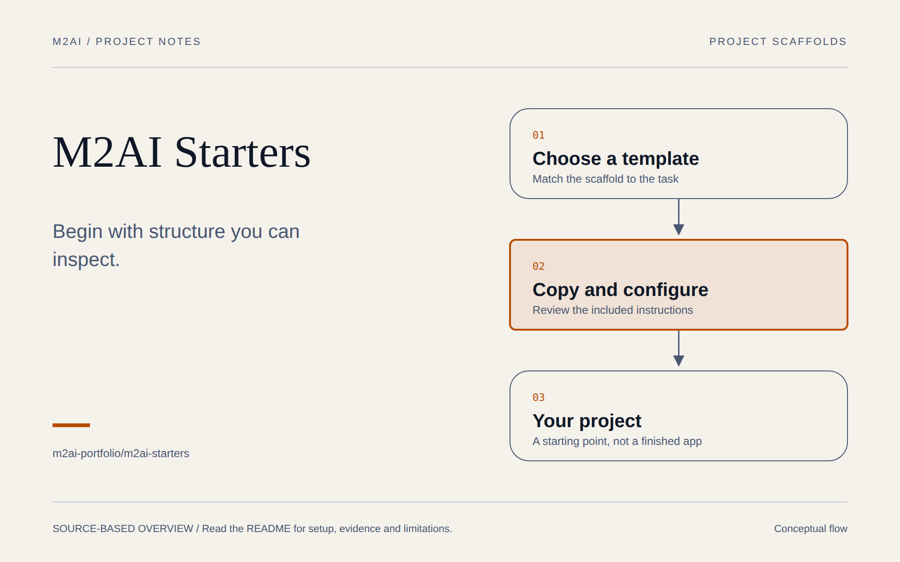

# M2AI Starters



A new agent project often starts with the same questions: who owns the work, where does state live, which instructions load, and what actually enforces the rules? M2AI Starters packages those decisions into small, readable scaffolds so you can begin with structure and adapt it to your own environment.

Each template includes its own walkthrough. These are starting materials, not a hosted service or a ready-running autonomous team.

## Choose a starter

| Template | Use it when | Included assets |
|---|---|---|
| [agent-team](agent-team/) | You need a conductor and bounded specialist roles. | Agent identity template, conductor instructions, worked handoff chain, and a SQLite shared-log schema. |
| [claude-setup](claude-setup/) | Your assistant's configuration is becoming difficult to maintain. | User and project instructions, scoped rules, reference files, an example skill, a hook, and memory-format examples. |

## Set up

Requires Git to inspect the repository. Node.js/npm is needed only if you choose the documented `degit` copy route. The agent-team database example also requires `sqlite3`; the Claude configuration's sample hook requires `jq`.

```bash
git clone https://github.com/m2ai-portfolio/m2ai-starters.git
cd m2ai-starters
```

Read the selected template's README before copying it into an existing environment. To copy just one scaffold into a new directory:

```bash
npx degit m2ai-portfolio/m2ai-starters/agent-team ./my-agent-team
cd my-agent-team
sqlite3 store/hive-mind.db < store/schema.sql
```

`degit` downloads files without the source repository's Git history. The SQL command creates the example coordination log; it does not launch agents or configure an orchestration service.

## First walkthrough: an agent team

1. Read [the team README](agent-team/README.md) and [worked chain](agent-team/docs/chain-example.md).
2. Copy `agents/_template/agent.yaml.example` for one specialist, then fill in its actual identity, tools, and routing description.
3. Give that specialist a `CLAUDE.md` describing its scope and boundaries.
4. Replace the conductor's placeholders and add that specialist to its routing table.
5. Choose your execution environment, validate the supported model identifiers, and test one handoff with an observable result before adding more agents.

## First walkthrough: assistant configuration

1. Read [the configuration README](claude-setup/README.md).
2. Replace the sample paths, hosts, and placeholders with your own facts.
3. Review existing configuration before merging files. Do not overwrite a working setup wholesale.
4. Merge the example hook settings, verify its `jq` dependency, and test the hook in a disposable repository.
5. Start a new Claude Code session and inspect the loaded memory and rules with `/memory`.

The distinction matters: a written instruction depends on the model following it; an enforcement hook runs at a tool boundary. Neither substitutes for the surrounding system's permissions.

## Extend the collection

Add a small subdirectory with its own README, explain what the scaffold creates and requires, and add it to the table above. Keep sample values visibly marked and validate the walkthrough from a clean directory.

Built by Matthew Snow / [M2AI](https://memyselfplusai.com). No license file is included in this snapshot. Template references to external runtimes describe examples and require adaptation.
